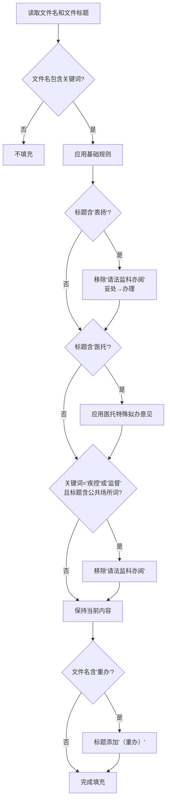

# 投诉批办单管理系统 - 智能填充规则说明

## 概述

系统根据**文件名**和**文件标题**中的关键词自动填充拟办意见和办理结果。规则实现位于 `main.py` 中的 `KeywordMatcher` 类。

---

## 一、基础匹配规则

系统通过扫描文件名中的关键词，自动填充对应的拟办意见和办理结果。

### 关键词优先级

⚠️ **重要**：匹配顺序固定，"中医院"必须在"中医"之前检查，避免误匹配。

### 规则表

| 关键词 | 拟办意见 | 办理结果 |
|:------|:---------|:---------|
| **中医院** | 请莉莉同志阅，请高鹏同志阅示。<br>建议：请中医医院妥处。 | 信息中心已转中医医院。 |
| **医政** | 请莉莉同志阅，请吕宁同志阅示。<br>建议：请医政科妥处，请法监科亦阅。 | 信息中心已转医政科。 |
| **公卫** | 请莉莉同志阅，请吕宁同志阅示。<br>建议：请公卫科妥处，请法监科亦阅。 | 信息中心已转公卫科。 |
| **疾控** | 请莉莉同志阅，请高鹏同志阅示。<br>建议：请疾控中心（监督所、健教所）妥处，请法监科亦阅。 | 信息中心已转疾控中心（监督所、健教所）。 |
| **发展** | 请莉莉同志阅，请吕宁同志阅示。<br>建议：请家庭发展科妥处。 | 信息中心已转家庭发展科。 |
| **妇计** | 请莉莉同志阅，请高鹏同志阅示。<br>建议：请妇计中心妥处。 | 信息中心已转妇计中心。 |
| **中医** | 请莉莉同志阅，请吕宁同志阅示。<br>建议：请中医科妥处，请法监科亦阅。 | 信息中心已转中医科。 |
| **监督** | 请莉莉同志阅，请高鹏同志阅示。<br>建议：请疾控中心（监督所、健教所）妥处，请法监科亦阅。 | 信息中心已转疾控中心（监督所、健教所）。 |

### 匹配逻辑

```
文件名包含关键词 → 应用对应的拟办意见和办理结果 → 检查特殊规则
```

**代码位置**：`main.py:409-442`

---

## 二、特殊覆盖规则

特殊规则在基础规则匹配成功后执行，会修改或替换基础规则生成的内容。

### 规则 1：表扬类

#### 触发条件
- 文件标题中包含 **"表扬"**

#### 处理逻辑
1. 移除拟办意见中的 `，请法监科亦阅`
2. 将拟办意见中的 `妥处` 替换为 `办理`

#### 示例
- **原始**（医政）：`请莉莉同志阅，请吕宁同志阅示。\n建议：请医政科妥处，请法监科亦阅。`
- **转换后**：`请莉莉同志阅，请吕宁同志阅示。\n建议：请医政科办理。`

**代码位置**：`main.py:451-455`

---

### 规则 2：医托类

#### 触发条件
- 文件标题中包含 **"医托"**

#### 处理逻辑
完全替换拟办意见为特殊格式：

```
请莉莉同志阅，请吕宁同志阅示，请高鹏同志亦阅。
建议：请{科室}牵头办理，及时移交线索并做好纠纷化解，请法监科联合公安、市场监管局组织集中打击，请疾控中心（监督所、健教所）严查严处。
```

其中 `{科室}` 根据文件名关键词确定：
- 文件名含"医政" → `医政科`
- 文件名含"中医" → `中医科`
- 其他情况 → 保持原关键词

#### 示例
- 文件名：`热线工单WXXCX6101002026050401939_医政.doc`
- 文件标题：`关于XX医院医托问题的投诉`
- **拟办意见**：
  ```
  请莉莉同志阅，请吕宁同志阅示，请高鹏同志亦阅。
  建议：请医政科牵头办理，及时移交线索并做好纠纷化解，请法监科联合公安、市场监管局组织集中打击，请疾控中心（监督所、健教所）严查严处。
  ```

**代码位置**：`main.py:457-468`

---

### 规则 3：疾控/监督的公共场所类

#### 触发条件
同时满足以下两个条件：
1. 文件名包含 **"疾控"** 或 **"监督"**
2. 文件标题包含以下任一公共场所关键词：
   - `酒店`
   - `宾馆`
   - `民宿`
   - `泳`（游泳馆、泳池等）
   - `理发`
   - `美发`
   - `健康证`
   - `卫生证`
   - `卫生许可证`
   - `浴`（浴室、洗浴等）
   - `美甲`
   - `烟`（吸烟、烟雾等）

#### 处理逻辑
移除拟办意见中的 `，请法监科亦阅`

#### 示例
- **原始**（疾控）：`请莉莉同志阅，请高鹏同志阅示。\n建议：请疾控中心（监督所、健教所）妥处，请法监科亦阅。`
- **转换后**：`请莉莉同志阅，请高鹏同志阅示。\n建议：请疾控中心（监督所、健教所）妥处。`

**代码位置**：`main.py:470-480`

---

## 三、文件标题特殊处理

### 重办标记

#### 触发条件
- 文件名包含 **"重办"**

#### 处理逻辑
在文件标题末尾自动添加 `（重办）`（如果标题中尚未包含）

#### 示例
- 文件名：`热线工单WXXCX6101002026050401939_重办.doc`
- 原标题：`关于XX医院收费问题的投诉`
- **填充后标题**：`关于XX医院收费问题的投诉（重办）`

**代码位置**：`main.py:929-932`

---

## 四、规则应用场景

智能填充在以下操作中自动触发：

1. **PDF文件转批办单**
   - 代码位置：`main.py:890-897`
   
2. **DOC文件转批办单**
   - 代码位置：`main.py:959-965`
   
3. **批量处理文件**
   - 代码位置：`gui_app.py:2888-2927`

---

## 五、规则执行流程



---

## 六、注意事项

1. **规则硬编码**：所有规则写死在 `KeywordMatcher` 类中，修改需编辑源代码
2. **匹配优先级**：必须保持"中医院"在"中医"之前检查
3. **特殊规则覆盖**：后执行的特殊规则会覆盖前面规则的内容
4. **关键词区分大小写**：当前实现对大小写敏感
5. **部分匹配**：只要文件名/标题**包含**关键词即可，不需要完全匹配

---

## 七、扩展建议

### 当前限制
- 规则硬编码在代码中
- 不支持界面配置
- 难以快速调整规则

### 改进方向
1. 将规则提取到外部配置文件（JSON/YAML）
2. 增加规则管理界面
3. 支持正则表达式匹配
4. 增加规则优先级配置
5. 支持多条件组合判断

---

**文档版本**：v1.0  
**最后更新**：2026-09-18  
**对应系统版本**：v1.38.2
